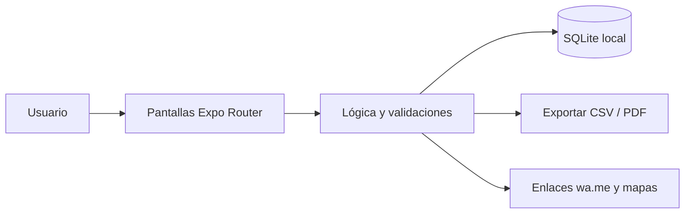

<div align="center">


# RepartoRuta

**Rutas de reparto y preventa: clientes por ruta y día, entregas, cobros y cierre de ruta sin conexión.**

[](LICENSE)
[](https://github.com/LuisRocha2080/RepartoRuta/actions/workflows/ci.yml)


[Vista rápida](#vista-rápida) · [Características](#características) · [Stack](#stack) · [Roadmap](#roadmap) · [Modelo comercial](#modelo-comercial) · [Inicio rápido](#inicio-rápido) · [Contribuir](#contribuir)

</div>

---

## Vista rápida

| | |
|---|---|
| **Para quién** | Distribuidores pequeños, preventistas y repartidores de bebidas, abarrotes, lácteos y panificados |
| **Problema** | El repartidor anota todo en una libreta: se olvida clientes, duplica cobros y al volver no cuadra la caja con la mercadería entregada. |
| **Solución** | App móvil que funciona sin internet y guarda todo en el teléfono. |
| **Costo de licencias** | Bs 0: Expo, React Native, SQLite y TypeScript son de código abierto. |

## Características

- Rutas por día de la semana con clientes en orden de visita.
- Visita con productos entregados, cantidades y precio.
- Motivo de no venta (cerrado, sin dinero, no quiso).
- Cobros de saldos anteriores y cuenta corriente por cliente.
- Apertura de la dirección del cliente en la app de mapas del teléfono.
- Cierre de ruta: entregado, cobrado, pendiente y diferencia de caja.

Sin servidores, sin suscripciones obligatorias y sin servicios de pago: todos los datos viven en el dispositivo (SQLite).

## Stack

| Capa | Tecnología |
|---|---|
| App | React Native + Expo (TypeScript) |
| Datos | SQLite local (`expo-sqlite`) |
| Navegación | Expo Router |
| Pruebas | Jest + `tsc --noEmit` |
| Distribución | APK directo / EAS Build local |

### Modelo de datos

- `rutas` (id, nombre, dia_semana)
- `clientes` (id, ruta_id, nombre, direccion, telefono, lat, lng, orden)
- `productos` (id, nombre, precio, activo)
- `visitas` (id, cliente_id, fecha, estado, motivo_no_venta)
- `visita_items` (id, visita_id, producto_id, cantidad, precio)
- `cobros` (id, cliente_id, fecha, monto)

Detalle completo: [docs/DATOS.md](docs/DATOS.md).

## Arquitectura



## Roadmap

1. Base y navegación
2. Rutas y clientes
3. Visitas y entregas
4. Cobros y cuenta corriente
5. Cierre y piloto

Detalle fase por fase: [docs/ROADMAP.md](docs/ROADMAP.md) · [docs/SPEC.md](docs/SPEC.md) · [docs/PLANNING.md](docs/PLANNING.md) · [docs/DATOS.md](docs/DATOS.md) · [docs/PANTALLAS.md](docs/PANTALLAS.md) · [docs/PRUEBAS.md](docs/PRUEBAS.md) · [docs/BACKLOG.md](docs/BACKLOG.md) · [docs/NEGOCIO.md](docs/NEGOCIO.md)

## Modelo comercial

- **Cómo se vende:** Plan por repartidor al mes o pago único por distribuidora.
- **Precio de partida:** Hipótesis a validar: Bs 40 al mes por repartidor o Bs 300 pago único.
- **Canal:** Distribuidoras pequeñas y preventistas de empresas medianas.
- **Piloto:** 3 distribuidores por 30 días, midiendo visitas registradas y diferencias de caja al cierre.

Los precios son hipótesis para validar con clientes reales antes de fijarlos. Ver [docs/NEGOCIO.md](docs/NEGOCIO.md).

## Estructura

```
RepartoRuta/
├── app/            # Pantallas y rutas (Expo Router)
├── src/
│   ├── db/         # Esquema y consultas SQLite
│   ├── components/ # Componentes reutilizables
│   └── lib/        # Utilidades
├── docs/           # Roadmap, specs, planificación, datos, pantallas, pruebas, backlog
└── .github/        # Plantillas, CI y Dependabot
```

## Inicio rápido

Requisitos: Node.js 20+ y la app Expo Go (o un emulador).

```bash
git clone https://github.com/LuisRocha2080/RepartoRuta.git
cd RepartoRuta
npm install
npx expo start
```

> El repositorio está en **fase inicial**: la documentación y la estructura están listas y el código de la app se construye siguiendo el [roadmap](docs/ROADMAP.md).

## Pruebas

```bash
npm test
npx tsc --noEmit
```

## Seguridad

Los datos no salen del teléfono. Para reportar una vulnerabilidad lee [SECURITY.md](SECURITY.md).

## Lo que todavía no existe

- No optimiza rutas automáticamente en la primera versión.
- Sin control de stock del camión de reparto.
- Un solo dispositivo por ruta.

## Contribuir

Lee la [guía de contribución](CONTRIBUTING.md) y el [código de conducta](CODE_OF_CONDUCT.md). Para dudas, consulta [SUPPORT.md](SUPPORT.md).

## Licencia

Distribuido bajo licencia MIT. Consulta [LICENSE](LICENSE).

---

<div align="center">Hecho por <a href="https://github.com/LuisRocha2080">LuisRocha2080</a></div>
