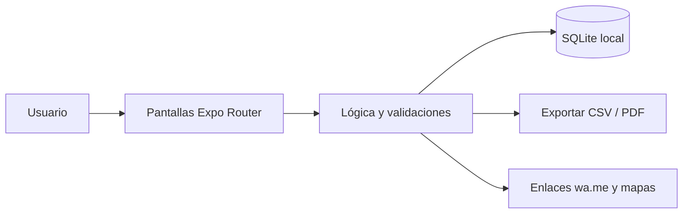

<div align="center">


# 🚚 RepartoRuta

**Rutas de reparto y preventa: clientes por ruta y día, entregas, cobros y cierre de ruta sin conexión.**

[](LICENSE)
[](https://github.com/LuisRocha2080/RepartoRuta/actions/workflows/ci.yml)


[Inicio rápido](#-inicio-rápido) · [Características](#-características) · [Arquitectura](#️-arquitectura) · [Roadmap](#️-roadmap) · [Pruebas](#-pruebas) · [Limitaciones](#-lo-que-todavía-no-existe) · [Contribuir](#-contribuir)

</div>

El repartidor anota todo en una libreta: se olvida clientes, duplica cobros y al volver no cuadra la caja con la mercadería entregada. **RepartoRuta** es una app móvil (Android) hecha con React Native + Expo y SQLite local, pensada para distribuidores pequeños, preventistas y repartidores de bebidas, abarrotes, lácteos y panificados. Funciona sin internet, sin servidores y sin licencias de pago. **Todavía no es una app lista para usar:** hoy el repositorio contiene la especificación, el plan, el modelo de datos, el diseño de pantallas y la base de configuración; el código de la app llega por fases (ver [Roadmap](#️-roadmap) y [Lo que todavía no existe](#-lo-que-todavía-no-existe)).

## 🎬 Vista rápida

> Aún no hay capturas: la app no está implementada. Las pantallas planificadas están descritas en [docs/PANTALLAS.md](docs/PANTALLAS.md) y se agregarán capturas reales al cerrar la primera fase.

Flujo principal:

```
Ruta de hoy → Visita → Clientes → Productos → Cuenta corriente → Cierre de ruta
```

| Pantalla | Qué muestra |
|---|---|
| Ruta de hoy | Clientes del día con estado: pendiente, visitado, no venta. |
| Visita | Productos, cantidades, cobro y notas. |
| Clientes | Ficha con dirección, teléfono, ubicación y saldo. |
| Productos | Catálogo y precios. |
| Cuenta corriente | Movimientos y saldo por cliente. |
| Cierre de ruta | Totales del día y exportación a CSV. |

## ✨ Características

| Característica | Detalle |
|---|---|
| Rutas por día | Rutas por día de la semana con clientes en orden de visita. |
| Visita con productos | Visita con productos entregados, cantidades y precio. |
| Motivo de no | Motivo de no venta (cerrado, sin dinero, no quiso). |
| Cobros de saldos | Cobros de saldos anteriores y cuenta corriente por cliente. |
| Apertura de la | Apertura de la dirección del cliente en la app de mapas del teléfono. |
| Cierre de ruta | Cierre de ruta: entregado, cobrado, pendiente y diferencia de caja. |

Todos los datos viven en el dispositivo (SQLite): sin cuentas, sin suscripciones y sin servicios de pago.

## 🏗️ Arquitectura



| Capa | Tecnología |
|---|---|
| App | React Native + Expo (TypeScript) |
| Datos | SQLite local (`expo-sqlite`) |
| Navegación | Expo Router |
| Pruebas | Jest + `tsc --noEmit` |
| Distribución | APK directo / EAS Build local |

**Modelo de datos**

| Tabla | Campos |
|---|---|
| `rutas` | id, nombre, dia_semana |
| `clientes` | id, ruta_id, nombre, direccion, telefono, lat, lng, orden |
| `productos` | id, nombre, precio, activo |
| `visitas` | id, cliente_id, fecha, estado, motivo_no_venta |
| `visita_items` | id, visita_id, producto_id, cantidad, precio |
| `cobros` | id, cliente_id, fecha, monto |

<details>
<summary>Estructura de carpetas</summary>

```
RepartoRuta/
├── app/                 # pantallas (Expo Router)
├── src/
│   ├── components/      # componentes de interfaz
│   ├── db/              # esquema y consultas SQLite
│   └── lib/             # lógica y validaciones
├── docs/                # especificación, roadmap, planificación, datos, pantallas, pruebas, backlog y negocio
├── .github/             # CI, CodeQL, Dependabot, plantillas de issues y PR
├── app.json · package.json · tsconfig.json
└── LICENSE · CHANGELOG.md · CONTRIBUTING.md · SECURITY.md · SUPPORT.md
```

</details>

## 🗺️ Roadmap

1. **Base y navegación:** Proyecto Expo + TypeScript, Esquema SQLite
2. **Rutas y clientes:** CRUD de rutas y clientes, Orden de visita
3. **Visitas y entregas:** Visita con productos, Motivo de no venta
4. **Cobros y cuenta corriente:** Cobros, Saldo por cliente
5. **Cierre y piloto:** Cierre de ruta, Exportación CSV, APK de prueba con 3 distribuidores piloto

Detalle fase por fase en [docs/ROADMAP.md](docs/ROADMAP.md). Documentación completa: [SPEC](docs/SPEC.md) · [PLANNING](docs/PLANNING.md) · [DATOS](docs/DATOS.md) · [PANTALLAS](docs/PANTALLAS.md) · [PRUEBAS](docs/PRUEBAS.md) · [BACKLOG](docs/BACKLOG.md) · [NEGOCIO](docs/NEGOCIO.md).

## 💼 Modelo comercial

| Aspecto | Detalle |
|---|---|
| Cómo se vende | Plan por repartidor al mes o pago único por distribuidora. |
| Precio de partida | Hipótesis a validar: Bs 40 al mes por repartidor o Bs 300 pago único. |
| Canal | Distribuidoras pequeñas y preventistas de empresas medianas. |
| Piloto | 3 distribuidores por 30 días, midiendo visitas registradas y diferencias de caja al cierre. |

Los precios son hipótesis para validar con clientes reales, no resultados medidos.

## 🚀 Inicio rápido

| Requisito | Versión |
|---|---|
| Node.js | 18+ |
| npm | 9+ |
| Android | Expo Go o emulador |

Clona el repositorio y entra a la carpeta.

```bash
git clone https://github.com/LuisRocha2080/RepartoRuta.git
cd RepartoRuta
```

Cuando exista el código de la app (fase 1 del roadmap), se instalará y arrancará así:

```bash
npm install
npm start        # Expo; escanea el QR con Expo Go
npm run android  # o en el emulador
```

> **No verificado:** `package.json` todavía no declara dependencias, así que `npm install` y `npm start` aún no levantan una app. Los scripts `npm test` y `npm run typecheck` sí están definidos y pasan sin pruebas todavía.

<details>
<summary>Variables de entorno</summary>

RepartoRuta no usa variables de entorno ni claves de API: todo funciona en el dispositivo. `.env.example` queda como plantilla vacía por si se agrega una integración (declarala sin valores reales).

</details>

## 🧪 Pruebas

Casos que la suite debe cubrir (definidos en [docs/PRUEBAS.md](docs/PRUEBAS.md)):

- Selección de ruta según día de la semana.
- Visita con varios productos y cobro parcial.
- Cierre con diferencia de caja.
- Reordenamiento de clientes.
- Apertura del mapa con coordenadas vacías.

Hoy `npm test` corre Jest sin pruebas (`--passWithNoTests`) y `npm run typecheck` ejecuta `tsc --noEmit`. El pipeline de CI y el análisis CodeQL corren en GitHub Actions en cada push y PR a `main`.

## 🔒 Seguridad

**Implementado:** no hay cuentas, contraseñas ni servidores; no se envían datos a terceros. El repositorio tiene activados el reporte privado de vulnerabilidades, Dependabot y la protección de secretos, y hay un workflow de CodeQL.

**Avisos importantes:**

- La base SQLite local no está cifrada: quien tenga acceso al dispositivo desbloqueado puede ver los datos.
- No hay copia de respaldo en la nube; si se pierde el teléfono se pierden los datos (la exportación a CSV/PDF está prevista en el diseño, ver [docs/SPEC.md](docs/SPEC.md)).
- Los problemas de seguridad se reportan según [SECURITY.md](SECURITY.md).

## 🚧 Lo que todavía no existe

- **La app en sí:** el repositorio es la base documental y de configuración; las pantallas, la base de datos y la lógica se construyen fase por fase (ver Roadmap).
- No optimiza rutas automáticamente en la primera versión.
- Sin control de stock del camión de reparto.
- Un solo dispositivo por ruta.
- Sin capturas de pantalla, sin pruebas automáticas reales y sin APK publicado.
- Los precios y el piloto del modelo comercial son hipótesis sin validar.

## 🤝 Contribuir

¡Las contribuciones son bienvenidas! Leé la [guía de contribución](CONTRIBUTING.md) y el [código de conducta](CODE_OF_CONDUCT.md) antes de abrir un PR. Para bugs o ideas usá las plantillas de issues; los problemas de seguridad se reportan según la [política de seguridad](SECURITY.md). ¿Dudas? Mirá [SUPPORT.md](SUPPORT.md). Los cambios por versión están en el [CHANGELOG](CHANGELOG.md).

## 📄 Licencia

Distribuido bajo la licencia MIT. Ver [LICENSE](LICENSE).

---

<div align="center">Hecho por <a href="https://github.com/LuisRocha2080">LuisRocha2080</a> · rutas de reparto y preventa con React Native, Expo y SQLite</div>
